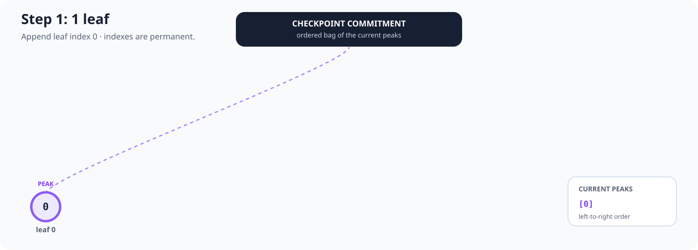
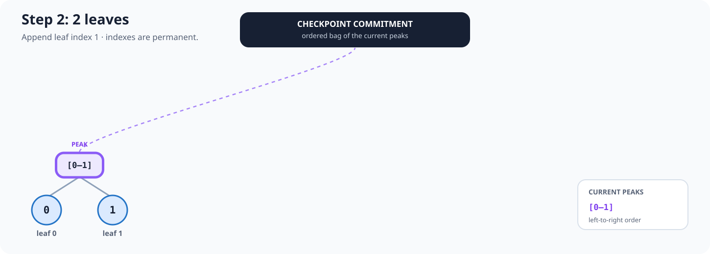
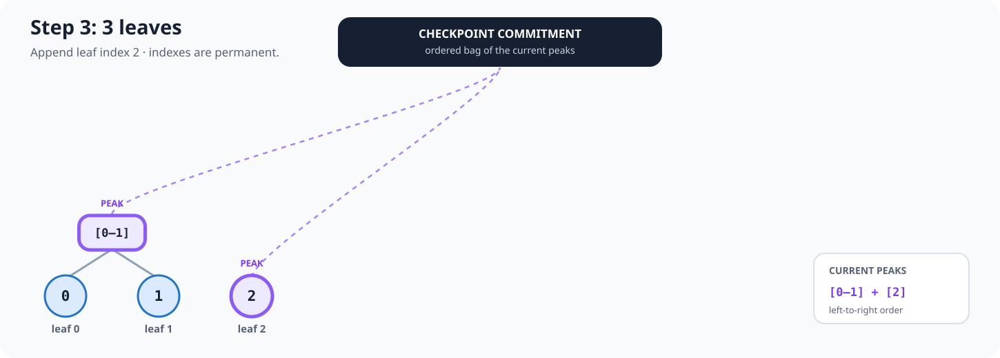
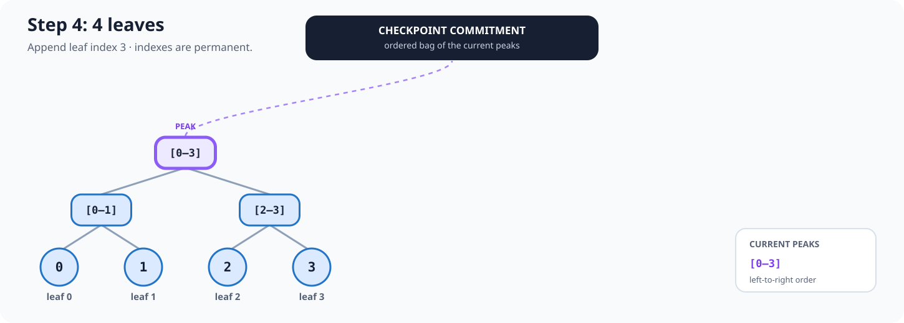
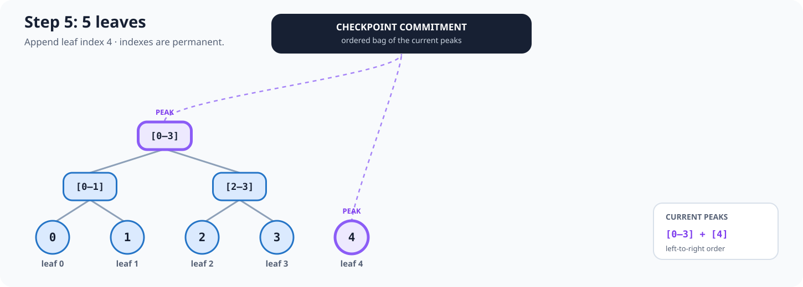
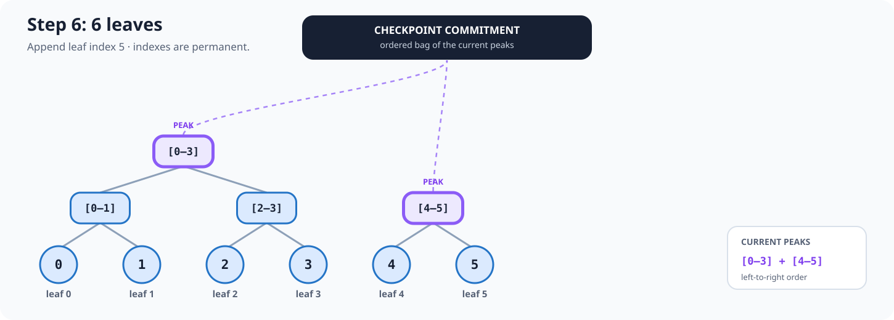
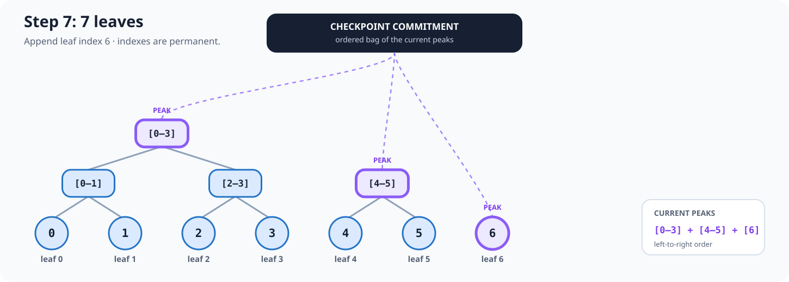
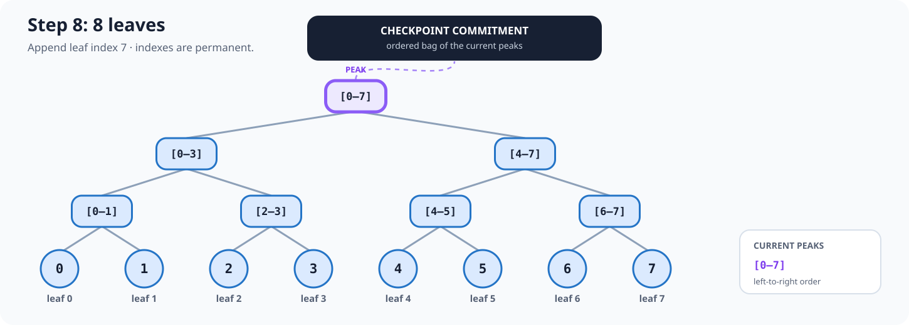

# Planned integrity service and Merkle Mountain Range

> **Status:** design stub only. RELIC does not yet implement this service, its
> database records, its command-line controls or its publication states.

This page records the intended boundary for RELIC's future append-only
integrity layer. It is deliberately descriptive rather than executable so the
team can agree the behaviour before choosing the schema and implementing it.

The proposed structure is a **Merkle Mountain Range (MMR)**. Unlike a balanced
Merkle tree rebuilt for every odd leaf count, an MMR keeps each complete tree
as a peak and merges equal-sized peaks when the next leaf arrives. Existing
leaf indexes and completed subtrees remain stable as the dataset grows.

## MMR visual explainer

Every accepted record receives a permanent, zero-based `leaf_index`. The
index is its position in the append-only integrity history, not a database ID,
timestamp or object identifier.

Purple nodes in the diagrams are the current peaks. The checkpoint commitment
is derived by combining those peaks in an exact, versioned left-to-right order.
The pictures explain topology only; the precise byte encoding and peak-bagging
construction remain an explicit design decision.

### 1. Start with leaf 0

### 2. Append leaf 1

The two one-leaf peaks merge into the complete `[0–1]` subtree.

### 3. Append leaf 2

There is no equal-sized peak to merge with leaf 2, so `[0–1]` and `[2]`
remain as separate mountains.

### 4. Append leaf 3

Leaves 2 and 3 merge, then the two two-leaf peaks merge into `[0–3]`.

### 5. Append leaf 4

The complete `[0–3]` tree is unchanged and leaf 4 becomes a second peak.

### 6. Append leaf 5

Leaves 4 and 5 merge. The peaks are now `[0–3]` and `[4–5]`.

### 7. Append leaf 6

Leaf 6 cannot yet merge. Three peaks cover all seven leaves without padding or
duplicating a leaf.

### 8. Append leaf 7

Leaf 7 triggers a carry: `[6–7]`, then `[4–7]`, then the complete `[0–7]`
tree. This is analogous to carrying bits in a binary counter.

The same pattern continues indefinitely. A leaf is appended once; only the
right-hand frontier changes.

## Intended component boundary

The design separates the tree algorithm from storage and operations:

- **`relic-mmr`** will be a pure Rust library for append operations, peak
  calculation, roots and proofs. It must not know about PostgreSQL.
- **`relic-postgres`** will adapt RELIC records and MMR state to PostgreSQL.
- **`relic-integrityd`** will be the normal long-running worker. It will catch
  up new leaves, persist nodes and checkpoints, and request signatures.
- **`relicctl`** will provide explicit status, verification, dry-run rebuild,
  recovery and manual-checkpoint operations. It is an administrative tool, not
  the normal record-processing path.

PostgreSQL should not start a command-line process from a trigger. The database
owns durable records and ordering; the worker owns the incremental computation.
PostgreSQL notification may wake the worker quickly, but notifications are only
hints. The worker must poll and reconcile from durable state because a
notification can be lost.

## Leaf-index constraints

- Leaf indexes begin at `0` and increase contiguously.
- An assigned index is immutable and is never reused.
- The index orders the integrity history; it does not replace the record's
  normal RELIC identifier.
- Allocation and insertion occur in the same database transaction.
- The allocator is a locked state record, not an ordinary sequence, so a
  rolled-back transaction does not create a gap.
- Concurrent submissions must serialize only the small allocation boundary,
  not the entire submission pipeline.

## Hashing constraints

The implementation must define and version all of the following before any
checkpoint is treated as evidence:

- the canonical bytes representing each covered RELIC record;
- the digest algorithm;
- separate hash domains for leaves, internal nodes and peak bagging;
- unambiguous left/right child ordering;
- the exact ordered construction that combines peaks;
- the format version carried by a checkpoint; and
- deterministic proof encoding and verification rules.

Changing any of these is a format migration, not a silent implementation
detail. No leaf duplication or invented padding leaf is used to handle an odd
count.

## Database responsibilities

The future schema is expected to represent four concepts. Names are
provisional:

- **integrity leaf** — the immutable leaf index, covered record identity,
  canonical-record digest and acceptance time;
- **MMR node** — persisted internal nodes required to resume, prove or verify;
- **MMR state/peaks** — the next leaf index and current ordered frontier;
- **MMR checkpoint** — leaf count, commitment, format version, signature,
  signing-key identity and creation time.

The database must enforce uniqueness, immutability and foreign-key integrity.
It must not claim that a record is sealed until the checkpoint covering that
leaf has been committed successfully.

## Worker behaviour

Only one active sequencer may advance an MMR. The proposed worker will use a
PostgreSQL advisory lock, read leaves in explicit `leaf_index` order, and apply
each append transactionally and idempotently.

On startup or after a notification it will compare durable leaves with durable
MMR state and catch up. It must stop rather than advance if stored peaks do not
match the state it independently expects. A crash between attempts must be
safe: restarting repeats or resumes work without changing an already committed
result.

The service should run under an unprivileged `relic` operating-system account.
Its database permissions should be limited to the integrity records it needs.

## Checkpoints and signing

A checkpoint commits to a specific leaf count and ordered set of peaks. The
private signing key remains outside PostgreSQL; PostgreSQL stores the
commitment, signature and public signing-key identity required for verification.

Checkpoint creation must be atomic from RELIC's point of view. Records may have
an intermediate state such as `accepted_pending_checkpoint`; only a completed
checkpoint can move covered records to `sealed`.

## Verification and recovery

RELIC must be able to rebuild the expected MMR independently from the immutable
leaves and compare it with stored nodes, peaks and signed checkpoints. A
rebuild defaults to dry-run and reports the first divergence. Recovery must not
overwrite conflicting evidence merely to make verification pass.

Proof generation and verification must state which checkpoint and leaf count
they target. A later checkpoint may cover more leaves, but it must not change
the meaning of an earlier signed checkpoint.

## Decisions still open

- Which record types enter this MMR, and whether there is one range or several.
- Exact canonical serialization and domain-separation constants.
- Exact peak-bagging construction.
- Checkpoint cadence: every append, time-based, count-based or explicit batch.
- Signature algorithm, key custody and rotation procedure.
- Whether publication waits for sealing or exposes a visible pending state.
- Which internal nodes are retained and whether safe pruning is ever allowed.
- Proof API, proof encoding and proof-retention requirements.
- Monitoring thresholds and the operational recovery procedure.

No implementation should quietly settle one of these choices. The selected
behaviour belongs in a reviewed format specification and regression vectors.
